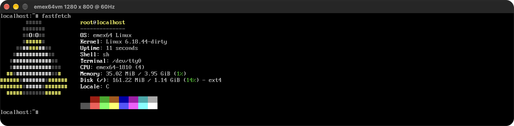

# emex64

Status: emulated only (emex64vm), no silicon yet, but planned. The Linux, musl and LLVM ports live in this repository.

<p align="left">
  
</p>

## Introduction
emex64 is a 64bit lightweight little endian architecture. It's a mix out of RISC and CISC it is based on no previous architecture, except the ones @mach-port-t(me) created in the past, emex64 evolved from this path LA8 -> LA816 -> LA16 -> LA32/LA64 -> emex64. emex64 is a much better version of LA64. LA stands for LightweightArchitecture, it is the original ISA, the idea of the ISA is to not hold baggage from decades ago and not bend for the industry giving the best result currently possible to the consumer.

Outside the SoC, the emulated board additionally integrates support for UART, (Re-Implementation pending (a vibecoder contributed audio before and was cought vibecoding which resulted in his code being removed)) Audio, and (implementation pending) Graphics.

Besides that there is a proper polymorphic toolchain called `EmexToolchain` which can be used to assemble, link and execute emex64 code all in the same process with proper memory management lavering `EmexFoundation`. The assembler spits out ELF relocatable objects, which the linker can either link all of them together to a firmware image which is something like emex64's BIOS or to a merged ELF relocatable object. ELF is the only thing that I didn't do from scratch, I originally wanted to use the LO(LightweightObject) format made by me, but thought then that this will be nightmares to implement.

## Setup and Installation of the minimal emex64 toolchain
Bulding the toolchain and installing it is as simple as the following:

```bash
make full
```

This will install emex64's toolchain and VM to `/usr/local`, and will prompt for a superuser password to do so.

On Linux hosts, emex64vm additionally requires GLFW/GLEW for the virtual display. On macOS hosts the display uses Metal, which comes with the system.

## Using the Virtual Machine (VM)
The VM can be invoked to run firmware with `emex64vm -f <image path>`. Test programs and the current testing firmware can be found in `./tests/`.

These examples will be compiled and directly run with `make`. 

## PCIe, SATA, USB and booting from storage
The VM has a PCIe root complex with a SATA host controller and a USB host controller on bus 0. Attach disk images with `--sata <image>` (or `--sata:ro <image>`), and plug in USB flash drives with `--usb <image>` (or `--usb:ro <image>`), up to 8 of each. emexFirmware enumerates PCIe, brings up the SATA disks, enumerates the USB devices (USB mass storage, Bulk-Only Transport with SCSI) and boots the first GPT disk that has an emex64 boot partition. Its PCIe, SATA, USB and boot code is written in C (`firmware/emexFirmware/c`) and built with clang (`llvm/`).

## C compiler (LLVM / Clang or GCC)
`llvm/` adds an emex64 backend to LLVM 23.1.5 with clang and lld. Register allocation over the 43 registers, a register based C ABI, the FPU, atomics, and an assembler and disassembler for emex64asm syntax. It is kept as changes to LLVM(`llvm/overlay`, `llvm/patches`). `llvm/build.sh` fetches LLVM, applies them and builds the toolchain into `llvm/install` (needs `git`, `cmake` and `ninja`), plus the runtime (compiler-rt builtins and a small libc for the bare machine).

#### LLVM
```bash
llvm/build.sh
llvm/install/bin/clang --target=emex64-unknown-elf -O2 -c foo.c -o foo.o
llvm/install/bin/ld.lld -T link.ld foo.o -o foo.elf
llvm/install/bin/llvm-objdump -d foo.elf
```

#### GCC
```bash
gcc/build.sh
```

`-msoft-float` builds code that leaves the FPU alone (kernels, firmware). emexFirmware's C parts are built with it.
